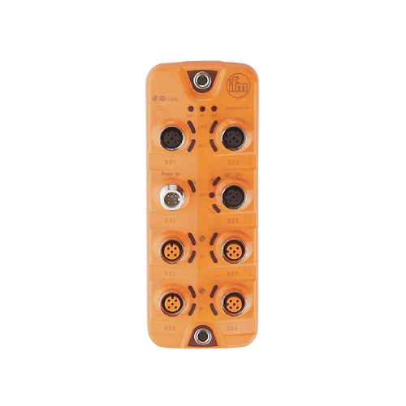

# IO-Link Smart Sensor Training Kit — Product Specification

**Ref:** IM-IOLINK-KIT-001  
**Issue:** 1.0  
**Date:** 2026-06-26  
**Prepared by:** Matrix TSL — development@matrixtsl.com

---

## Contents

1. [Educational Purpose](#1-educational-purpose)
2. [Learning Outcomes](#2-learning-outcomes)
3. [How the Product Works in Practice](#3-how-the-product-works-in-practice)
4. [System Architecture](#4-system-architecture)
5. [Key Features](#5-key-features)
6. [Learning Objectives](#6-learning-objectives)
7. [Worksheet Index](#7-worksheet-index)
8. [Curriculum Front Page](#8-curriculum-front-page)
9. [Main Components](#9-main-components)
10. [Buyer FAQ](#10-buyer-faq)
11. [Tender Specification](#11-tender-specification)
12. [Hardware Features](#12-hardware-features)
13. [Control and Communication Capabilities](#13-control-and-communication-capabilities)
14. [Performance Expectations](#14-performance-expectations)
15. [Electrical Safety Information](#15-electrical-safety-information)

---

## 1. Educational Purpose

The IO-Link Smart Sensor Training Kit teaches the dynamics of **industrial IO-Link sensor networks** in a hands-on, self-paced environment. Learners connect, configure, and diagnose a live 4-port IO-Link system built around industry-standard hardware — the same IFM AL1350 IO-Link Master, Omron proximity sensors, and IFM temperature sensors found on real factory floors.

The kit bridges the gap between theoretical sensor knowledge and the practical skills demanded by modern automation roles: reading live process data from a real IO-Link bus, writing ISDU parameters to reconfigure a sensor without physically removing it, diagnosing faults through device identity checks and event flags, and interpreting real-time HMI data on a Raspberry Pi kiosk.

Students do not simulate. Every parameter write goes to real hardware over a live network; every fault scenario injects a real misconfiguration that must be diagnosed and corrected. The IO-Link communication layer is exposed at every level — from the raw hex PDin byte to the human-readable engineering value on the gauge — so learners understand the full signal chain from sensor to screen.

---

## 2. Learning Outcomes

The kit delivers two sequential curriculum units totalling **19 hands-on modules** across two courses:

### CP0001 — Interactive Sensor Worksheets (8 modules)
Students meet each device in the kit, interact with live data, complete guided challenges, and diagnose realistic fault scenarios. By the end of CP0001 a student can:
- Identify and describe the purpose of each component in an IO-Link network
- Distinguish between digital, analogue, and IO-Link signal types
- Commission sensors by writing setpoints and calibration offsets via ISDU
- Diagnose and correct common sensor faults using IO-Link diagnostics
- Read and decode raw PDin hex data
- Operate a real IO-Link light stack via PDout commands

### CP0002 — Engineering Deep-Dive Worksheets (11 modules)
A technically rigorous second tier for aspiring controls engineers. Students go beneath the HMI layer to understand protocol internals, data decoding, PLC integration patterns, and maintenance economics. By the end of CP0002 a student can:
- Explain the IO-Link physical layer and acyclic service data channel (ISDU)
- Decode PDin payloads at the byte and bit level
- Articulate the business case for IO-Link vs conventional wiring
- Design parameter read/write sequences for PLC integration
- Analyse a PT100 resistance curve and explain IEC 60751 accuracy classes
- Encode and decode CL50 PDout 3-byte control words

---

## 3. How the Product Works in Practice

The kit operates as a **live industrial HMI system**, not a simulation. All sensor data originates from real hardware on a real IO-Link bus.

### Data Flow

1. The **IFM AL1350 IO-Link Master** polls its four sensor ports every 1–5 ms and buffers the latest process data values.
2. Every 500 ms the AL1350 publishes a structured JSON payload to a **Mosquitto MQTT broker** running on the Raspberry Pi.
3. The **FastAPI Python backend** subscribes to the MQTT broker and instantly broadcasts data over a **WebSocket** to any connected browser.
4. The **Chromium kiosk** (displayed on a 1024×600 WaveShare touchscreen) renders live gauges, charts, and status indicators that update every 500 ms without page refresh.
5. Students interact with sensors via **ISDU read/write controls** on the HMI — every control write travels from the browser → FastAPI → AL1350 → sensor over IO-Link in under 100 ms.

### ISDU Parameter Access (Acyclic Service Data)

Students write setpoints, calibration offsets, and output logic values directly to running sensors without stopping the production data stream. A circuit-breaker in the backend protects the AL1350 from overload; adaptive polling backs off disconnected ports automatically.

### Fault Scenario Injection

Worksheets include guided fault scenarios where a real misconfiguration is written to the live sensor (e.g. inverting proximity output logic to NC, injecting a +3 °C calibration offset). Students must observe the anomaly on the HMI, diagnose the root cause via ISDU reads, and write a corrective value — exactly as a field engineer would. Auto-restore logic in the firmware ensures the sensor returns to a safe state on navigation, even if the student does not complete the fix.

### CL50 Pro Light Stack Control

The Banner CL50 Pro LED light stack on Port 4 is controlled in real time via 3-byte PDout commands. Worksheets include colour selection, animation mode selection, and an intensity sweep mode implemented as a server-side background task that cycles brightness in a smooth breathing pattern. Students decode the PDout hex word from first principles.

---

## 4. System Architecture

```
┌────────────────────────────────────────────────────────────────────┐
│                     FACTORY NETWORK — 192.168.7.0/24               │
└──────────────┬──────────────────────────────────┬──────────────────┘
               │ Ethernet                         │ Ethernet
               │                                  │
┌──────────────▼──────────┐             ┌──────────▼──────────────────┐
│  IFM AL1350              │             │  Raspberry Pi 4              │
│  IO-Link Master          │             │  ─────────────────────────  │
│  IP: 192.168.7.4         │  ← MQTT →   │  Mosquitto MQTT Broker       │
│  4 × IO-Link ports       │             │  FastAPI + uvicorn (8000)    │
│  REST + MQTT API         │             │  nginx reverse proxy (80)    │
└──────────┬───────────────┘             │  Chromium kiosk (1024×600)  │
           │ IO-Link (M12, 3-wire)       └─────────────────────────────┘
    ┌──────┴─────────────────────────┐
    │         │           │          │
  Port 1    Port 2      Port 3     Port 4
    │         │           │          │
 ┌──▼──┐  ┌───▼──┐  ┌────▼──┐  ┌───▼─────┐
 │Omron│  │RS PRO│  │IFM    │  │Banner   │
 │E2E  │  │Cap.  │  │TV7105 │  │CL50 Pro │
 │Prox.│  │M18   │  │Temp   │  │LED Stack│
 └─────┘  └──────┘  └───────┘  └─────────┘
  PDin     PDin       PDin       PDout
```

### Component Roles

| Component | Role |
|-----------|------|
| **IFM AL1350 IO-Link Master** | Bridge between IO-Link sensor bus and Ethernet. Handles IO-Link protocol, buffers PDin/PDout, exposes REST API and MQTT publish. |
| **Mosquitto MQTT Broker** | Lightweight pub/sub message broker on the Raspberry Pi. Receives 500 ms pushes from the AL1350; decouples the backend from the master. |
| **FastAPI Backend (Python)** | Subscribes to MQTT, decodes sensor PDin payloads, manages ISDU read/write, forwards live data over WebSocket to the browser. |
| **Chromium HMI Kiosk** | Full-screen dashboard on the WaveShare touchscreen. Vite-built vanilla JS + Tailwind CSS + Chart.js. No framework dependency. |
| **Omron E2E-X16MB1T12 (Port 1)** | Inductive proximity sensor. 16 mm sensing range, M18. PDin: 16-bit (monitor output + OUT1/status flags). |
| **RS PRO / Carlo Gavazzi M18 (Port 2)** | Capacitive proximity sensor. Detects metal, liquid, and non-metallic materials. PDin: SSC1 switching output + quality of target. |
| **IFM TV7105 (Port 3)** | IO-Link temperature sensor, PT100/Pt1000. Two independent switching outputs (SP1/RP1, SP2/RP2). ISDU calibration offset. |
| **Banner CL50 Pro (Port 4)** | 50 mm programmable LED column light. PDout-only. Colour, animation, intensity and audible control via 3-byte PDout word. |
| **WaveShare 1024×600 Touchscreen** | Capacitive touchscreen display. Kiosk mode via Chromium on Openbox/X11. Touch emulated as mouse events. |

---

## 5. Key Features

- **Live IO-Link bus** — all four ports run real IO-Link hardware; no simulation or pre-recorded data
- **500 ms MQTT push architecture** — WebSocket HMI updates in under half a second; no page refresh required
- **Full ISDU parameter access** — read and write any sensor parameter (setpoints, calibration offset, output logic) from the HMI without stopping the live data stream
- **Guided fault-injection scenarios** — real misconfigurations injected and auto-restored; students must diagnose and correct the live sensor
- **19 structured worksheets across two courses** — CP0001 (8 modules, beginner) and CP0002 (11 modules, engineering-level)
- **Multiple-choice progress tracking** — MCQ answers stored per session, exportable as JSON; SVG progress rings per course
- **Raspberry Pi kiosk deployment** — self-contained, no internet required; runs on a 1024×600 WaveShare touchscreen in full-screen Chromium
- **GitHub Pages static deployment** — UI-only version deployable as a public-facing course reference site
- **CL50 Pro PDout control** — interactive colour picker, animation selector, live hex preview, and server-side intensity sweep workaround for firmware limitation
- **IO-Link vendor/device registry** — 260+ vendor names from IO-Link Community XML v252; device names for all four kit sensors
- **Circuit-breaker backend reliability** — protects the AL1350 from overload; auto-recovers after 15 s; degraded-mode HTTP fallback if MQTT is unavailable
- **Global display zoom** — settings-page zoom control (50–150%) with Pi kiosk white-space compensation; persists across sessions
- **Multiple dark/light themes** — DaisyUI theme selector; persists via `localStorage`

---

## 6. Learning Objectives

By completing both curriculum units, a student will be able to:

1. **Describe the IO-Link standard** (IEC 61131-9) — physical layer, communication speeds, cable requirements, and the difference between process data (cyclic) and service data (acyclic ISDU).
2. **Commission a real IO-Link sensor network** — connect sensors to a 4-port master, verify port modes, identify devices by vendor ID and device ID, and confirm live PDin data on an HMI.
3. **Read and write ISDU parameters** — use the HMI ISDU controls to read setpoints and configuration registers from a running sensor, interpret the raw hex values, and write corrected or new values.
4. **Diagnose and rectify common IO-Link sensor faults** — identify inverted output logic, calibration drift, wrong device identity, and communication loss using the diagnostics available from an IO-Link system.
5. **Decode PDin and PDout data from first principles** — convert raw hex PDin bytes to engineering values using dtype, bit offset, and scale factor; encode a PDout control word for an LED light stack.
6. **Explain the MQTT push architecture** — describe the role of the broker, publish/subscribe pattern, and why push messaging is preferable to HTTP polling for real-time HMI applications.
7. **Articulate the commercial benefit of IO-Link** — quantify reduced wiring costs, faster fault resolution time, and remote reconfiguration capability versus conventional 4–20 mA or digital I/O wiring.
8. **Apply IO-Link concepts to PLC integration** — describe how a PLC reads ISDU data via the IO-Link Master, and sketch a basic data mapping from sensor parameter to PLC address.

---

## 7. Worksheet Index

### CP0001 — Interactive Worksheets

| # | Title | Key Activities |
|---|-------|----------------|
| WS1 | Meet Your Kit | Kit tour, live proximity/capacitive challenge, MCQ knowledge check |
| WS2 | What is a Smart Sensor? | Digital vs analogue vs IO-Link signal animations, randomised fault diagnosis scenario, MCQ |
| WS3 | The Proximity Sensor | Omron E2E inductive sensing, ISDU output-logic misconfiguration scenario, guided fix and verify |
| WS4 | The Capacitive Sensor | Commissioning challenge, SSC1 setpoint write, detection counter via ISDU |
| WS5 | The Temperature Sensor | SP/RP setpoint control, calibration drift scenario (CAL-0189), ISDU offset write |
| WS6 | The Light Stack | CL50 PDout colour and animation control, maintenance scenario (stale PDout), live sweep demo |
| WS7 | Fault Finding and Replacement | NC proximity fault + light stack clue, end-to-end field diagnosis exercise |
| WS8 | Final Practical Assessment | Hex decode, PDout colour task, knowledge-check MCQ across all four devices |

### CP0002 — Engineering Worksheets

| # | Title | Key Topics |
|---|-------|------------|
| WS1 | Your System — A Technical Brief | System architecture, component roles, network topology |
| WS2 | How This App Works | FastAPI, WebSocket, MQTT, Vite frontend, backend reliability patterns |
| WS3 | How Each Sensor Works (Protocol Level) | IO-Link PDin structure, IODD, cyclic vs acyclic data |
| WS4 | Benefits for Maintenance | Remote reconfiguration, predictive diagnostics, cost comparison vs conventional wiring |
| WS5 | Decoding IO-Link Data | PDin hex decode exercises, dtype table, scale factors, two's complement |
| WS6 | Diagnostics: Process, Service, and Event Data | Event flags, ISDU service channel, supervision data (voltage, current, temperature) |
| WS7 | PLC and HMI Integration | IO-Link Master as gateway, PROFINET/EtherNet-IP mapping concepts, data address blocks |
| WS8 | Case Study — Standard vs IO-Link: The Numbers | Wiring cost, commissioning time, fault MTTR, 5-year TCO comparison |
| WS9 | Device Identity — Vendor ID, Device ID & PDin | Vendor/device ID registry, live device identity reads, IODD lookup |
| WS10 | PT100 Temperature Sensors — From Resistance to Process Data | IEC 60751 accuracy, resistance curve, PDin hex decode, calibration offset |
| WS11 | CL50 Pro — PDout Encoding Deep-Dive | 3-byte PDout structure, bit-field encoding, colour index table, hex preview tool |

---

## 8. Curriculum Front Page

---

### IO-Link Smart Sensor Training Kit

**Course Codes:** CP0001 · CP0002  
**Level:** Introductory (CP0001) / Engineering (CP0002)  
**Format:** Self-paced, live hardware, browser-based HMI  
**Prerequisites:** Basic electrical knowledge; no prior IO-Link experience required

---

This training kit puts you in front of a real, running IO-Link sensor network. You will not watch a simulation — you will read live data from real sensors, write parameters that change how they behave, and fix faults you have injected yourself.

**CP0001** walks you through each device in the kit: a proximity sensor, a capacitive sensor, a temperature sensor, and a programmable LED light stack. Eight guided worksheets take you from first contact with the hardware through commissioning, fault diagnosis, and a final practical assessment.

**CP0002** goes beneath the surface. Eleven engineering worksheets decode the protocol, map the data pipeline from sensor byte to PLC address, and build the commercial argument for IO-Link over conventional wiring. By the end you will understand the full signal chain — from the IO-Link bit frame on the M12 cable to the hex value in your FastAPI response.

**What you will use:**

| Hardware | Software |
|----------|----------|
| IFM AL1350 IO-Link Master | Raspberry Pi HMI Dashboard |
| Omron E2E Proximity Sensor | FastAPI Backend + MQTT |
| RS PRO Capacitive Sensor | Browser-based Worksheets |
| IFM TV7105 Temperature Sensor | Live ISDU Read/Write Controls |
| Banner CL50 Pro LED Light Stack | Progress Tracking + JSON Export |

---

## 9. Main Components

### IFM AL1350 IO-Link Master



The IFM AL1350 is an industrial 4-port IO-Link Master with integrated Ethernet connectivity. It runs the IO-Link protocol on each M12 port (COM2 / COM3 speeds), buffers process data values, and exposes a REST API plus MQTT publish service to the network. In this kit it acts as the bridge between the sensor bus and the Raspberry Pi.

**Key specs:**

| Property | Value |
|----------|-------|
| IO-Link ports | 4 × Class A M12 (5-pin) |
| IO-Link speeds | COM2 (38.4 kbaud), COM3 (230.4 kbaud) |
| Network interface | 10/100 Ethernet, IP configurable |
| Supply voltage | 24 V DC |
| MQTT publish interval | 500 ms (firmware minimum) |
| Operating temperature | −25 °C to +70 °C |

---

### Omron E2E-X16MB1T12 — Inductive Proximity Sensor (Port 1)

An industry-standard M18 inductive proximity sensor with IO-Link COM2. Detects ferrous and non-ferrous metals up to 16 mm. PDin is 16 bits: byte 0 = monitor output amplitude (0–255), byte 1 = OUT1 and diagnostic flags (instability alarm, over-approach alarm, warning, error).

---

### RS PRO / Carlo Gavazzi CA18FAF08BP — Capacitive Proximity Sensor (Port 2)

M18 capacitive sensor with IO-Link. Detects metal, liquid, and non-metallic materials through container walls. SSC1 setpoint configurable via ISDU (index 60, subindex 1). Includes quality-of-target output for commissioning confidence.

---

### IFM TV7105 — Temperature Sensor (Port 3)

PT100/Pt1000 IO-Link temperature sensor with two independent switching outputs. Each output has a Switch Point (SP) and Reset Point (RP) configurable via ISDU (indices 583, 584, 593, 594). Calibration offset available at index 681, range ±10 °C, scale 0.1 °C/LSB.

---

### Banner CL50 Pro — Programmable LED Light Stack (Port 4)

50 mm column light with full RGB colour selection, animation modes, and audible alert. PDout-only device controlled by a 3-byte control word. Supports steady, flash, two-colour flash, strobe, three-pulse, SOS, and intensity-sweep animation modes. 16 colour indices including white, cyan, and custom.

---

## 10. Buyer FAQ

**Q: Does the kit require an internet connection to operate?**  
A: No. The kit is entirely self-contained. The Raspberry Pi runs the MQTT broker, FastAPI backend, and Chromium kiosk locally. An internet connection is only required for the optional GitHub Pages static deployment.

**Q: How many students can use the kit simultaneously?**  
A: The kit is designed for one student or pair at a time — it has one physical sensor network and one kiosk screen. Multiple browser connections to the WebSocket are supported, but there is one shared IO-Link bus. For classroom use, one kit per bench pair is recommended.

**Q: Can the worksheets be used without the hardware (e.g. at home)?**  
A: The GitHub Pages deployment provides the full UI and curriculum content (CP0001 and CP0002) without a backend. ISDU controls and live data panels are gracefully disabled when no backend is reachable. Students can read all theory content, review MCQ answers, and study the reference material without hardware.

**Q: What prior knowledge do students need?**  
A: CP0001 requires only basic electrical knowledge (voltage, current, switching outputs). No programming knowledge is needed. CP0002 assumes CP0001 completion and a basic understanding of computer networks (IP address, client/server). No PLC programming experience is required.

**Q: Can we add our own sensors?**  
A: Yes. The IFM AL1350 supports any IO-Link device. Adding a sensor requires registering its IODD-derived parameters in `backend/device_parameters.py` and optionally adding a vendor/device name entry in `src/io-link-vendors.js`. The UI will auto-detect and display the new device on the IO-Link Master page.

**Q: How is student progress measured?**  
A: The Progress page tracks which worksheets have been visited in the current session (CP0001 and CP0002 separately). MCQ results are stored in session memory. A JSON snapshot of all progress can be exported at any time. Progress resets on browser close (session storage, not local storage), so each class can start fresh.

**Q: What is the expected service life of the hardware?**  
A: All sensors and the IO-Link Master are industrial-grade components rated for continuous operation. The Omron E2E proximity sensor is rated for 10 million switching operations. The IFM TV7105 has no moving parts. Typical training environment lifespan is 5+ years under normal classroom use.

**Q: Is technical support available?**  
A: The kit is supplied with full source code, CLAUDE.md developer documentation, and this specification document. Matrix TSL provides email support at development@matrixtsl.com.

**Q: Can the kit be integrated with a PLC?**  
A: The AL1350 supports PROFINET and EtherNet/IP gateway mode for PLC integration. CP0002 Worksheet 7 covers the data-mapping concepts. Physical PLC connection is not included in the base kit but the master is fully compatible with Siemens, Allen-Bradley, and Mitsubishi controllers.

**Q: What is the total power consumption?**  
A: Approximately 25–30 W in normal operation: AL1350 (~5 W) + Raspberry Pi 4 (~6 W idle, ~10 W load) + sensors (~2 W combined) + WaveShare display (~8 W). Everything runs from a single 24 V DC / 2 A supply — the Raspberry Pi is powered via an internal DC-to-DC converter on the panel board. No separate Pi supply is needed.

---

## 11. Tender Specification

The supplier shall provide a fully operational **IO-Link Smart Sensor Training Kit** comprising the hardware, software, and curriculum content described in this document, meeting the following contractual requirements:

### 11.1 Hardware Supply

The kit shall include, as a minimum:

| Item | Specification |
|------|---------------|
| IO-Link Master | IFM AL1350 or AL1300/AL1100 (4-port, Ethernet) |
| Proximity sensor | Omron E2E series or equivalent, M18, IO-Link COM2, ≥10 mm range |
| Capacitive sensor | RS PRO / Carlo Gavazzi CA18FAF08BP or equivalent, M18, IO-Link |
| Temperature sensor | IFM TV7105 or equivalent, PT100, IO-Link, dual switching outputs |
| LED light stack | Banner CL50 Pro or equivalent, 50 mm, IO-Link PDout, RGB |
| HMI controller | Raspberry Pi 4 (2 GB RAM minimum) with SD card (≥16 GB) |
| Display | WaveShare 7" 1024×600 capacitive touchscreen or equivalent |
| Network | Unmanaged Ethernet switch, minimum 4-port |
| Cables | M12 5-pin IO-Link cables for all sensor connections; Ethernet patch cables |
| Power supply | 24 V DC DIN-rail PSU ≥2 A (Pi powered via internal DC-to-DC converter from 24 V rail) |

### 11.2 Software Delivery

- Complete source code for the HMI dashboard, FastAPI backend, and deployment scripts
- Pre-built production image deployable to Raspberry Pi with a single SCP + systemd command
- GitHub Actions CI workflow for automated GitHub Pages deployment
- All curriculum content (CP0001 and CP0002) embedded in the frontend application
- Python requirements file (`requirements.txt`) and `package.json` for reproducible builds

### 11.3 Curriculum Content

- **CP0001:** Minimum 8 interactive worksheets covering the four sensor types, fault diagnosis, and a final practical assessment with MCQ
- **CP0002:** Minimum 11 engineering worksheets covering protocol internals, data decoding, PLC integration, and commercial justification
- All MCQ questions shall have a documented answer key
- Fault scenarios shall use real ISDU writes to live hardware; simulated faults are not acceptable

### 11.4 Functional Requirements

The system shall:

1. Display live sensor process data with a maximum latency of 1 second from sensor event to HMI update under normal network conditions
2. Support ISDU parameter read and write for all four connected sensors without interrupting the live data stream
3. Recover automatically from IO-Link Master disconnection within 15 seconds
4. Retain theme and zoom settings across browser sessions via `localStorage`
5. Operate without any cloud dependency; all services shall run on the local Raspberry Pi
6. Support deployment to GitHub Pages as a static UI-only resource site with degraded-mode graceful fallback

### 11.5 Acceptance Criteria

Acceptance testing shall verify:

- Live PDin data updates visible on the HMI within 1 second of sensor state change
- Successful ISDU read/write on all four ports
- Fault scenario injection and auto-restore on navigation (WS3 proximity, WS5 temperature calibration)
- CL50 PDout colour change reflected on hardware within 500 ms of HMI write
- All CP0001 and CP0002 worksheets navigable; MCQ answers scorable
- Progress page JSON export contains correct visited-worksheet data

---

## 12. Hardware Features

### Enclosure and Mounting

- Industrial sensors mounted on a **panel or DIN-rail base** suitable for benchtop use
- M18 sensors use **industry-standard M12 5-pin IO-Link cables** with quick-disconnect connectors (no tools required for sensor swap)
- AL1350 master mounts via standard DIN-rail clip; sensors mount via threaded M18 bodies with locking nuts
- Cable management via cable ties or spiral wrap; cable lengths ≥ 500 mm for bench flexibility
- WaveShare display and Raspberry Pi mounted in a compact enclosure or stand; display tilt-adjustable

### Materials

| Component | Material |
|-----------|----------|
| Sensor bodies | Nickel-plated brass (M18) |
| Sensor faces | PBT (polybutylene terephthalate) |
| AL1350 housing | Glass-fibre reinforced PA |
| M12 cable jacket | PUR (polyurethane, oil-resistant) |
| Display bezel | ABS plastic |

### Dimensions (approximate)

| Component | Dimensions |
|-----------|-----------|
| AL1350 Master | 80 × 50 × 35 mm |
| M18 Sensors | ∅18 mm × 60 mm body |
| CL50 Light Stack | ∅50 mm × 160 mm (single segment) |
| WaveShare Display | 165 × 100 × 20 mm |
| Raspberry Pi 4 | 85 × 56 × 17 mm |

---

## 13. Control and Communication Capabilities

### HMI Interface

- Browser-based, runs in Chromium on Pi kiosk or any modern desktop browser
- Responsive layout: drawer sidebar at ≤1280 px wide (kiosk), fixed sidebar on larger screens
- Global display zoom (50–150%) with kiosk white-space compensation
- Multiple themes (light/dark/industrial) via DaisyUI theme selector
- Touch-capable: drag-to-scroll sidebar, large hit targets for kiosk use

### Connectivity

| Interface | Specification |
|-----------|---------------|
| Ethernet | 10/100 Base-T; static or DHCP IP |
| IO-Link | IEC 61131-9, COM2/COM3, up to 20 m cable |
| MQTT | MQTT 3.1.1; Mosquitto broker on Pi; QoS 0 |
| WebSocket | ws:// on port 80 (proxied via nginx) |
| REST API | FastAPI on port 8000; proxied via nginx at /api/ |

### USB

- Raspberry Pi USB-A ports available for USB drive curriculum export
- Keyboard/mouse connection for setup and maintenance (not required in kiosk mode)

### Wi-Fi / LAN

- Raspberry Pi 4 built-in Wi-Fi (802.11ac) — available for remote SSH or browser access
- Primary connection: Gigabit Ethernet to local IO-Link subnet
- SSH access on standard port 22 (host: `iolink.local` via mDNS or fixed IP)

### Remote Access

- SSH: standard OpenSSH server on Pi
- Remote Chromium debug: port 9222 always open in kiosk mode
- Web dashboard: accessible from any browser on the local network at `http://iolink.local`

---

## 14. Performance Expectations

| Metric | Specification |
|--------|---------------|
| HMI update latency | ≤ 500 ms sensor-to-screen (MQTT push path) |
| ISDU read round-trip | < 200 ms typical (AL1350 → sensor → response) |
| ISDU write round-trip | < 200 ms typical |
| HTTP fallback polling rate | 1 Hz per connected port; 0.2 Hz per disconnected port |
| Circuit-breaker recovery time | 15 s after 5 consecutive failures |
| Chart buffer size | 50 data points per series (memory-constrained for Pi) |
| Chart redraw rate | 1 update per 2 seconds (flush-throttled) |
| Device tree cache TTL | 5 minutes |
| WebSocket reconnect | Automatic; exponential backoff with jitter |
| Concurrent browser connections | Unlimited (WebSocket broadcast) |
| Raspberry Pi CPU load (nominal) | ~97% Chromium renderer; ~5% Python backend |
| AL1350 max concurrent HTTP connections | 3 (hardware limit; connection pool enforced) |

### Real-Time Data

All sensor readings (PDin) originate from the AL1350's 500 ms MQTT publish cycle. There is no data batching or averaging in the push path — each WebSocket message carries the latest raw PDin value decoded to engineering units. Chart series are capped at 50 points to prevent memory growth on the Pi.

### Digital Control

PDout writes to the CL50 light stack are acknowledged by the AL1350 within one HTTP round-trip (< 200 ms). The backend software sweep task cycles at configurable step intervals (40 ms / 100 ms / 250 ms depending on speed setting).

---

## 15. Electrical Safety Information

### Supply Voltages

| Rail | Voltage | Purpose |
|------|---------|---------|
| System supply | 24 V DC ±10% | IO-Link Master, all sensors, and Raspberry Pi (via panel DC-to-DC converter) |

The 24 V DC supply rail is SELV (Safety Extra-Low Voltage) per IEC 61140. No mains voltage is present within the IO-Link sensor network. The Raspberry Pi receives 5 V from an internal DC-to-DC converter mounted on the panel board — there is no separate Pi power supply.

### Protective Earth

The AL1350 and DIN-rail enclosure shall be connected to protective earth (PE) per IEC 61140. Sensor bodies (metal M18) are not required to be earthed but should be connected to the system reference potential (0 V) via Pin 3 of the M12 connector.

### Fusing

The 24 V DC rail shall be fused at the PSU output. Recommended fuse rating: 2 A fast-acting. The DC-to-DC converter output to the Raspberry Pi should include a 3 A self-resetting polyfuse.

### Cable and Connector Ratings

- M12 IO-Link cables: rated 30 V, 4 A minimum (PUR jacket, IP67 connector)
- Ethernet patch cables: Cat5e minimum, unshielded acceptable for benchtop distances
- All connectors keyed to prevent incorrect insertion

### IP Rating

| Component | IP Rating |
|-----------|-----------|
| IFM AL1350 | IP67 |
| Omron E2E Sensor | IP67 |
| RS PRO Capacitive Sensor | IP67 |
| IFM TV7105 | IP67 |
| Banner CL50 Pro | IP65 |
| Raspberry Pi (open board) | IP0 — must be housed |
| WaveShare Display | IP54 (front bezel) |

Sensors and master are rated for wash-down environments. The Raspberry Pi and display must not be exposed to water or excessive humidity; house in an enclosure rated ≥IP54 for any non-benchtop deployment.

### Regulatory Compliance

- IO-Link standard: **IEC 61131-9**
- Sensor accuracy: **IEC 60751** (TV7105 PT100)
- Low voltage: **2014/35/EU** (LVD)
- EMC: **2014/30/EU**
- RoHS: All components supplied comply with **RoHS 3 (2015/863/EU)**

### Safe Handling Notes

- Do not exceed 26.4 V DC (24 V + 10%) on the IO-Link supply rail
- Do not short IO-Link cable Pin 1 (24 V) to Pin 3 (0 V); the AL1350 has internal short-circuit protection but repeated shorts may degrade the port driver
- The CL50 LED light stack contains bright LEDs; avoid prolonged direct eye contact at close range when set to high intensity
- Temperature sensor body (TV7105) may be warm during operation in high-ambient environments; handle with care

---

*End of specification — IM-IOLINK-KIT-001 Issue 1.0*
